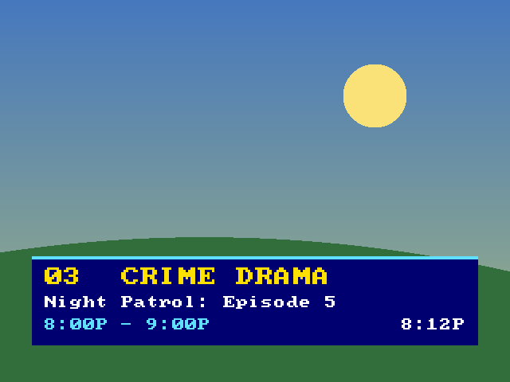
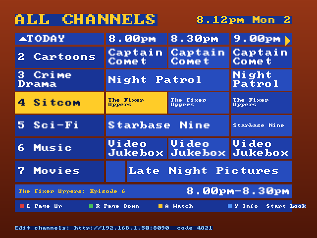
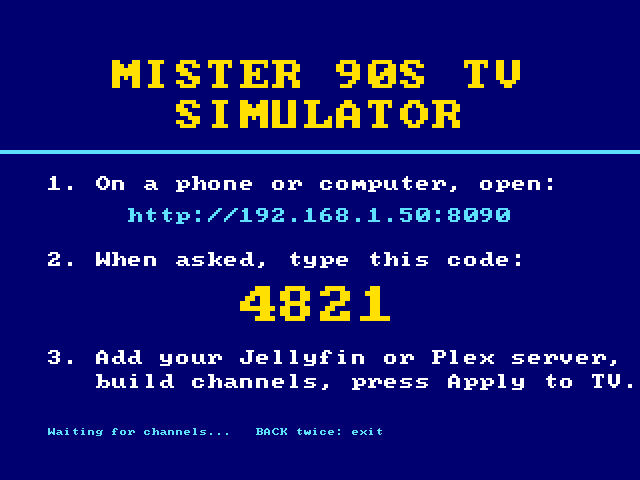
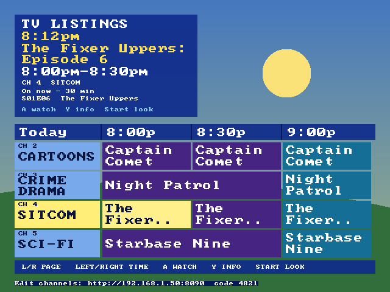
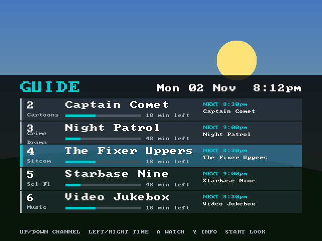

# MiSTer 90s TV Simulator

Turn a MiSTer into a 90s set-top box. It builds **live TV channels from your own Jellyfin and Plex libraries**: shows start on the half hour, ad breaks fill the gaps, a scrolling guide lists what's on, and changing channel goes through a burst of static. Point it at a CRT and press channel up. You start it like any other core: **Other → MiSTer 90s TV**.

> **Version 0.6b (beta).** Tested on one MiSTer (analog CRT output), Jellyfin 10.11 and Plex 1.43. Expect rough edges and please report them.

| Channel banner | Guide (Satellite look) | Set-up screen |
|---|---|---|
|  |  |  |

*(These pictures are drawn by the player's own code with invented sample shows.)*

## What it does

- **Live channels.** Each channel runs a schedule that is the same for everyone and every device, so tuning in at 8:17 joins the show 17 minutes in. Programmes sit on a 30 or 60 minute grid and ad breaks (up to 15 minutes, only when the slot has time left) are filled with clips you choose.
- **Your libraries.** Jellyfin and Plex, as many servers as you like. Pick series, whole libraries, playlists or collections, filter by length, and make your own lists.
- **The FPGA decodes the video** whenever it can: H.264 Main/High up to 720p30 (480p60) plays straight from your server. Anything else (HEVC, MPEG-2/4, 1080p, Baseline H.264) is transcoded by Plex or Jellyfin on your server.
- **Seamless ad breaks.** A programme, its ads and the next show play as one stream, with no gap between clips.
- **A TV guide with four looks.** Satellite (a full-screen grid in the manner of UK and Australian boxes), Cable (an information panel over the live picture, in the manner of US cable boxes), Modern (a see-through now-and-next panel) and Classic. Press **Start** (or `M`) in the guide to change the look, or pick one in Studio. Only the layouts and colours are inspired by those boxes: no logos, names or adverts.
- **Picture shapes for a 4:3 screen.** One button cycles Fit, Fill, 14:9, Zoom 16:9 and Zoom 2.35, remembered per show. It's done by editing the stream's cropping fields, so there is no re-encoding.
- **Set up from any browser.** The MiSTer hosts a small web page (Studio). The TV shows its address and a code; you do everything else from a phone or computer.

## What you need

- A **MiSTer FPGA** with a network connection (Ethernet or Wi-Fi) and a correct clock: the schedule follows the wall clock.
- The **H.264 core** by owenb321 ([MiSTer_h264_decoder](https://github.com/owenb321/MiSTer_h264_decoder)). The installer can download it for you (it asks first and checks the published checksum).
- A **Jellyfin** or **Plex** server on your home network. Transcoding needs a server with enough CPU; direct-play files need almost none.

## Install

1. Copy `Install_MiSTer_90s_TV.sh` to the `Scripts` folder on the MiSTer's SD card.
2. On the MiSTer open **Scripts → Install_MiSTer_90s_TV** (or run `bash /media/fat/Scripts/Install_MiSTer_90s_TV.sh` over SSH). The MiSTer must be online. The Scripts menu is only for installing and uninstalling: you start it from the **Other** core menu.

It puts these on the SD card and touches nothing outside `/media/fat`:

| Where | What |
|---|---|
| `Scripts/.config/MiSTer_90s_TV/` | the program, the web page, your sign-ins, indexed libraries, channels, lists, logos and logs (about 5 MB) |
| `MiSTer_90s_TV/` | ffmpeg 7.0.2 (about 31 MB), downloaded and checked against a pinned SHA-256 |
| `_Other/MiSTer 90s TV_<date>.rbf` | the menu entry, listed as **Other → MiSTer 90s TV** with its date like any core. It is a copy of owenb321's H.264 core under this program's name (the MiSTer menu only shows dates for `.rbf` cores). **Run the installer again after updating the H.264 core** so the copy follows it. |
| `linux/user-startup.sh` | three lines (between `MiSTer 90s TV Simulator` marker lines) that start a small background program at boot. It waits for you to choose the menu entry and then starts the player; it also keeps the web page running. **The installer asks before adding them.** |
| `Scripts/Uninstall_MiSTer_90s_TV.sh` | removes everything above, including those three lines |
| `_Other/H264_*.rbf` | owenb321's core, only if it isn't there already and you say yes |

Run the installer again at any time to upgrade; your channels and sign-ins are kept.

## First run

1. Open **Other → MiSTer 90s TV**. The TV shows a blue screen with an **address** (like `http://192.168.1.50:8090`) and a **four-digit code**.
2. On a phone or computer on the same network, open that address and type the code.
3. Under **Sources** choose **+ Add Jellyfin or Plex**.
   - *Jellyfin:* the server's network address, and an API key (Dashboard → API Keys) or your user name and password (the password is not kept).
   - *Plex:* **Sign in with Plex**, approve in the Plex page that opens, come back, pick your server. The sign-in is kept on the MiSTer, so it survives the page being closed or a phone going to sleep.
   - Use the server's **network address**, not `localhost`: Studio runs on the MiSTer.
4. Let it index (about 40 seconds for 5,000 items), then **Create starter channels** or build your own.
5. Press **Apply to TV**. The TV switches from the set-up screen to your channels within a few seconds.

Studio shows the address and code again on the guide screen. Anyone on your network who knows the code can use it; it isn't reachable from the internet unless you forward a port, which you shouldn't.

## Remote control

| | Gamepad | Keyboard |
|---|---|---|
| Channel up / down | Up / Down, or L / R | Up / Down, `.` / `,` |
| Go to a channel | | type its number (row or keypad), then wait or press Enter |
| Show / hide the info banner | A | Enter or Space |
| TV guide | X or Select | `G` or Tab |
| Next / previous picture shape | Start (Y outside the guide) / Left | `M`, `Z` or Right / Left |
| Leave to the MiSTer menu | B twice | Esc twice |

In the guide, Up/Down move between channels, Left/Right move to the previous or next programme, L / R page through the channels, **Y shows the details** of the highlighted programme (episode, year, rating, length and the server's description; press Y or B to close), **Start changes the look**, and A tunes to the highlighted channel.

## The guide looks

| Satellite | Cable | Modern |
|---|---|---|
|  |  |  |

The guide is drawn over the live picture, and the core blends it, so the Cable and Modern looks leave the picture visible. The look is chosen with **Start** on the TV or under **Guide look** in Studio, and is remembered.

## Studio (the web page)

- **Sources:** add, test, re-index and remove servers.
- **Library:** *Browse* libraries, series, playlists and collections (merge same-named series, hide what you don't want); *Find items* by title; *My lists* of your own picks. Tick items to add them to a pool or a list, or hide them.
- **Channels:** name and number, programme slot length, no-repeat window, longest ad break, programme pools (shuffle or in order, with length and title filters), the ad pool, and day parts (which pool plays when).
- **Preview** a channel's day, then **Apply to TV**.

## How it decides what plays directly

An item plays on the FPGA only if it is H.264 **Main or High**, 8-bit 4:2:0, progressive, at most 1280×720, within 108,000 macroblocks per second (720p30 or 480p60), and under about 8 Mbit/s. Everything else goes through the server's transcoder (to H.264 High, 854×480, AAC stereo, about 2.5 Mbit/s). Studio shows how many items in each pool play directly and how many need transcoding.

## Good to know

- **Changing channel:** direct files take about a second, Jellyfin transcodes about 1.5 seconds, Plex transcodes about 5 to 6 seconds. The static covers the wait.
- **Subtitles** are not shown. Only stereo sound is played.
- **Time zone:** if the schedule is hours off, the MiSTer's clock or time zone is wrong.
- **Indexing while watching** can make the picture stutter on the MiSTer's slow processor. Do set-up while the TV is idle.
- **Credentials** (API keys, Plex tokens) are stored in plain text in `Scripts/.config/MiSTer_90s_TV/studio/config.json` on the SD card. The web page never sends them back to the browser.

## Troubleshooting

- **Test bars, no picture:** the H.264 core isn't loaded or isn't answering. Run the installer again to check the core, then reboot the MiSTer.
- **The player quit to the menu:** read `Scripts/.config/MiSTer_90s_TV/log.txt` (and `studio.log`). The player reloads a stuck core by itself a few times before giving up.
- **A channel plays only station idents / "back in a moment":** it has nothing scheduled right now. Studio leaves out channels with no items; check the pool's filters.
- **Plex shows nothing after Apply:** check the source's address is reachable from the MiSTer (a plain `http://192.168.x.x:32400` is the simplest).
- **Choosing the menu entry only shows a test pattern:** the background starter isn't running. It starts at boot (reboot once after installing), or start it by hand with `bash /media/fat/Scripts/.config/MiSTer_90s_TV/daemon.sh`.
- **Remove everything:** run `Uninstall_MiSTer_90s_TV` from the Scripts menu.

## How it works (short)

`tvsim/schedule.py` generates each channel's day from a seed, so every device agrees on what's on. The player (`tvsim/player/`) feeds H.264 access units and 48 kHz audio into the core's ring buffer in shared memory, rebasing each clip's timestamps so a chain of clips plays as one. On-screen graphics are an ARGB page in the Linux framebuffer that the core draws over the picture. Studio (`tvsim/studio/`) is a standard-library Python web server. See [DESIGN.md](DESIGN.md) for the design notes.

## Building from source

Python 3.9 or newer, no third-party packages.

```
python -m unittest discover -s tests          # the tests
python tools/make_installer.py                # builds release/Install_MiSTer_90s_TV.sh
python tools/make_release.py                  # the installer plus its checksum
python -m tvsim.studio                        # Studio on a PC, http://127.0.0.1:8090
```

## How this code was written

The code in this repository was written by an LLM working under human direction. The human contribution was research, compiling, running each build on real hardware, finding what broke, and narrowing it down to a root cause.

This is stated up front because it is a fair thing for anyone evaluating the code to know. It is not an endorsement of the approach — draw your own conclusions.

## Licence and credits

Licensed under the **GNU General Public Licence, version 2** (see `LICENSE`). Parts were copied from the author's earlier MiSTer player, which is GPL-2.0.

This program does not include, and is not affiliated with, any of the following. See [NOTICE.md](NOTICE.md) for details.

- The **H.264 core** by owenb321 (GPL-3.0-or-later) does the decoding. The installer downloads it from the author's release page.
- **ffmpeg** 7.0.2 (GPLv3, John Van Sickle's static build as packaged by eugeneware/ffmpeg-static) is downloaded by the installer.
- **Plex**, **Jellyfin** and **MiSTer** are the property of their owners.
